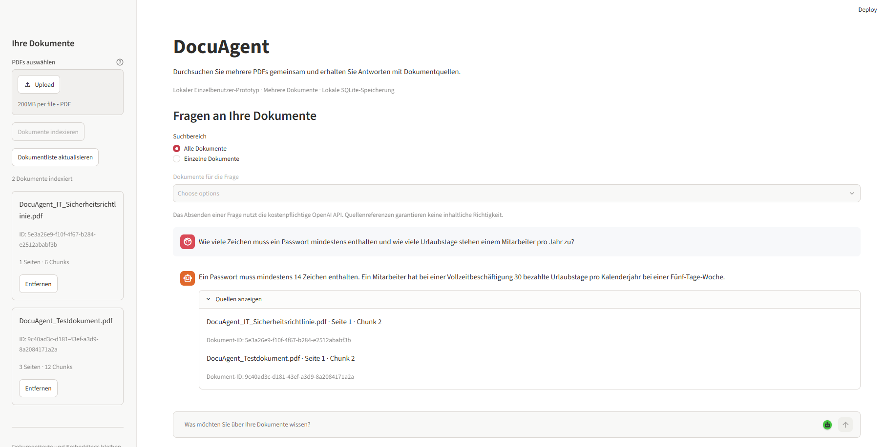
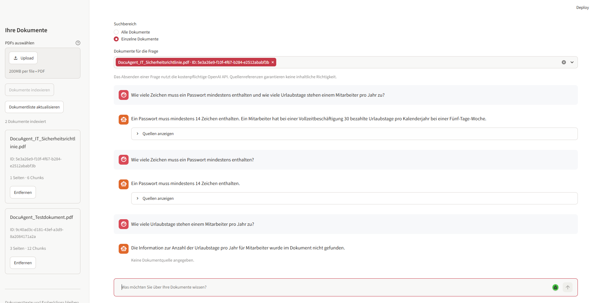
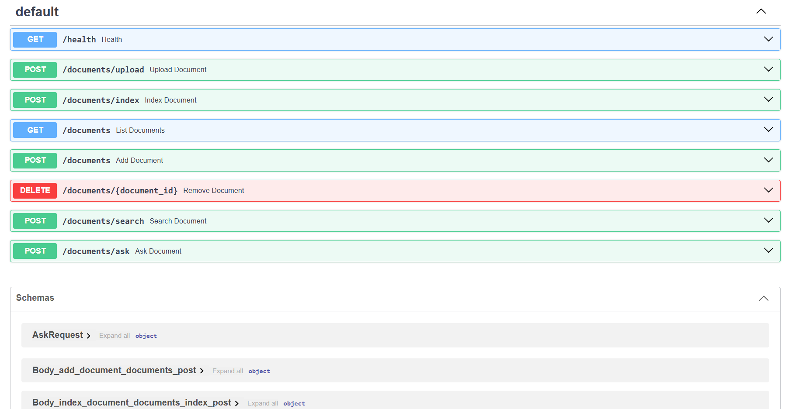
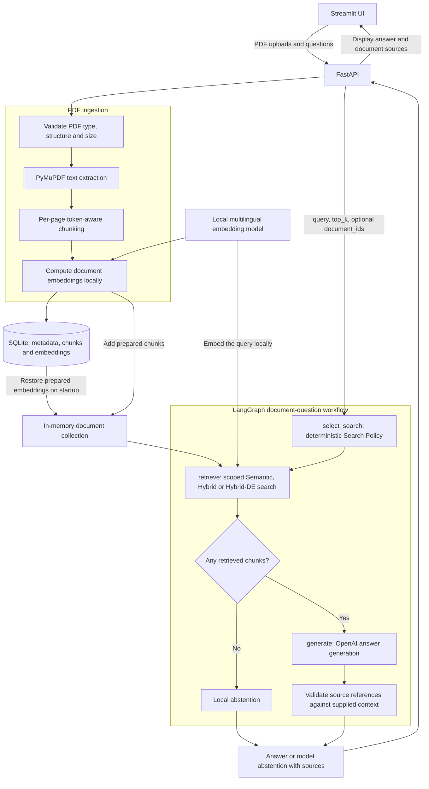
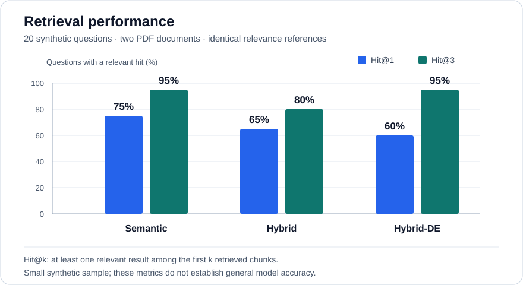

# DocuAgent

[](https://github.com/mokhtarrezaee1991/docuagent/actions/workflows/ci.yml)
[](https://www.python.org/)
[](https://fastapi.tiangolo.com/)
[](https://streamlit.io/)
[](https://github.com/langchain-ai/langgraph)
[](https://www.sqlite.org/)

**Ask questions across PDFs, with document-scoped retrieval and traceable sources.** DocuAgent combines local multilingual embeddings, persistent SQLite storage and a deterministic LangGraph workflow with GPT-4.1-mini answer generation.

**Status:** completed local portfolio prototype for a single user; not production-ready. The project includes 665 locally verified regression tests and documented retrieval and answer-quality experiments. Test counts measure software behavior, not model accuracy.

## Table of Contents

- [Project Overview](#project-overview)
- [Application Demo](#application-demo)
- [Key Features](#key-features)
- [System Architecture](#system-architecture)
- [Technology Stack](#technology-stack)
- [Retrieval and Generation Workflow](#retrieval-and-generation-workflow)
- [Evaluation Results](#evaluation-results)
- [Installation and Configuration](#installation-and-configuration)
- [Running the Application](#running-the-application)
- [Testing and Evaluation](#testing-and-evaluation)
- [Project Structure](#project-structure)
- [Architecture Decisions](#architecture-decisions)
- [Limitations](#limitations)
- [Roadmap](#roadmap)

## Project Overview

DocuAgent indexes multiple PDFs, retrieves passages within an explicit document scope, and generates answers with document, page and chunk references using OpenAI GPT-4.1-mini. Document embeddings are computed locally and persisted in SQLite.

The project explores the engineering boundaries of a small RAG system: input validation, reusable embeddings, deterministic orchestration, source constraints, offline evaluation and controlled paid-model experiments. Semantic search remains the default. Experiments that have not demonstrated independent value remain outside the application workflow.

See the [public evaluation summary](docs/public_evaluation_summary_20261125.md) for the measured results, evidence types and limitations.

## Application Demo

Authentic screenshots of the local application using the synthetic `DocuAgent_Testdokument.pdf` and `DocuAgent_IT_Sicherheitsrichtlinie.pdf` examples. These captures illustrate specific interactions, not general answer accuracy. The interface is in German.

### Multi-Document Question Answering

A question combines password and annual-leave information from two documents. The expanded sources show the filename, page, chunk and document ID for each reference.



### Document Filtering and Abstention

With only the IT security document selected, the final exchange shows abstention on an annual-leave question. Earlier chat messages remain visible; the final answer illustrates the selected document scope.



### Interactive REST API Documentation

FastAPI's Swagger UI lists the document-management, retrieval and question-answering endpoints with their request schemas.



The uploader's built-in widget label shows 200 MB; DocuAgent separately enforces a **10 MiB per-file limit** in the UI and backend. The screenshot does not demonstrate a larger upload allowance.

## Key Features

- Multi-PDF upload, document listing and individual deletion, with unique IDs even for identical filenames.
- PDF content-type, signature and parser validation; a 10 MiB upload limit.
- Per-page token-aware chunking with overlap, accounting for the embedding model's token limit and special tokens.
- Local multilingual embeddings reused across questions and restored from SQLite after restart.
- Semantic retrieval and optional BM25/RRF hybrid modes, including German Snowball normalization.
- Explicit document selection in the API and UI; an empty selection never becomes a global search.
- A deterministic LangGraph workflow for search planning, retrieval, generation or local abstention.
- Structured answers and technical validation of document/page/chunk source references.
- Offline retrieval experiments, synthetic answer fixtures and integrity-bound answer reviews.

The application has no autonomous LLM router, runtime LLM judge, automatic query rewriting, productive retry, or productive MMR selection.

## System Architecture

The diagram shows the integrated application only. Experimental quality diagnostics, retry, MMR and automatic retrieval-mode selection are excluded.



SQLite also persists successful additions and deletions. Original PDF files are not stored by this persistence layer. Invalid source references are rejected rather than returned as valid citations.

The graph is a fixed workflow, not autonomous tool reasoning. Nonempty retrieval results allow generation but do not establish that the question is answerable.

## Technology Stack

| Area | Implementation |
| --- | --- |
| Runtime | Python; tested locally with Python 3.11.8 |
| API | FastAPI, Uvicorn, Pydantic |
| UI | Streamlit, httpx |
| PDF processing | PyMuPDF |
| Embeddings | Sentence Transformers, PyTorch; CPU model loading |
| Embedding model | `sentence-transformers/paraphrase-multilingual-MiniLM-L12-v2` |
| Retrieval | Cosine similarity; rank-bm25; RRF; snowballstemmer |
| Workflow | LangGraph |
| Answer generation | Official OpenAI Python SDK; `gpt-4.1-mini` |
| Persistence | Local SQLite through Python's standard library |
| Testing | pytest, httpx TestClient and local SDK/HTTP mocks |

## Retrieval and Generation Workflow

1. Upload a PDF. The backend reads at most the size limit plus one byte and validates the file before extraction.
2. Extract page text and create chunks within the embedding model's token budget. Page references remain attached to each chunk.
3. Embed document chunks once, save metadata/text/vectors in SQLite and make them available in the current index.
4. Validate the question and document selection. Search only within the selected documents, before ranking and top-k.
5. Execute one configured retrieval mode. The local query embedding is new; document embeddings are reused.
6. If there are no hits, return a local abstention. Otherwise pass only the question and retrieved passages to the existing answer generator.
7. Validate returned source references against that exact context. A model can also abstain when nonempty context is insufficient.

### Retrieval modes

| Mode | Ranking |
| --- | --- |
| `semantic` | Multilingual embeddings and cosine similarity; default |
| `hybrid` | Semantic + BM25, equal-weight Reciprocal Rank Fusion with constant 60 |
| `hybrid_de` | Hybrid with German Snowball normalization applied to questions and document tokens |

Set the mode through backend configuration. The public question endpoint does not expose a `mode` field.

### API behavior

| Endpoint | Purpose |
| --- | --- |
| `GET /health` | Health check |
| `POST /documents` | Add a PDF without replacing previous documents |
| `GET /documents` | List indexed document metadata |
| `DELETE /documents/{document_id}` | Delete a document and its stored chunks |
| `POST /documents/search` | Retrieval without OpenAI answer generation |
| `POST /documents/ask` | Answer a question through the LangGraph workflow |
| `POST /documents/upload` | Extract page text without indexing |
| `POST /documents/index` | Compatibility endpoint that replaces the entire index after successful preparation |

Streamlit uses the append endpoint for multi-document uploads. For `/documents/ask`, the request is:

```json
{
  "query": "What does the selected document say?",
  "top_k": 3,
  "document_ids": ["an-id-returned-by-the-document-list"]
}
```

Omit `document_ids`, or use `null`, to search all documents. `[]` explicitly selects none. Duplicate IDs are deduplicated; invalid, unknown or deleted IDs are rejected. Sources contain document identity, filename, page and chunk references. The response retains `answer` and `sources`.

An empty index returns HTTP 409, invalid requests/scopes HTTP 422, missing answer-service configuration HTTP 503, and generation errors HTTP 502. The API requires a configured key for `/documents/ask` even when the final graph path abstains locally; that local path itself makes no model call.

## Evaluation Results

### Retrieval: original 20-question synthetic sample



| Method | Hit@1 | Hit@3 | Full-ranking MRR |
| --- | ---: | ---: | ---: |
| Semantic Search | 75% | 95% | 0.862500 |
| Hybrid Search | 65% | 80% | 0.765833 |
| German Hybrid Search | 60% | 95% | 0.776667 |

These results use two synthetic PDFs, the same relevance references and the same local embedding model. They support retaining Semantic as the default for this experiment, not a universal ranking claim. Later experiments use MRR@3, which is not the same as full-ranking MRR.

### Real answer pilot and review

A separate controlled pilot recorded six real model responses from frozen synthetic contexts, one supplied chunk per case:

| Item | Recorded value |
| --- | ---: |
| Development / test cases | 3 / 3 |
| Evaluated factual claims | 7 |
| Evaluated question facets | 10 |
| Technically valid source references | 5 |
| Justified abstentions, according to annotations | 3 |
| Input / output tokens | 2,409 / 276 |

The requested model was `gpt-4.1-mini`; recorded model metadata identifies `gpt-4.1-mini-2025-04-14`. An **AI-assisted semantic review through ChatGPT** supplied the explicit assessment decisions. On the applicable units, the recorded mean is 2/2: seven claims for correctness/faithfulness/citation coverage, five sources for source precision, and ten facets for completeness. These are review outcomes on a tiny selected sample, **not general production accuracy** or independent human evaluation.

Synthetic answer fixtures are separate regression data containing intentional faults; they are not a model-performance baseline. Details, including the D04 wording limitation and T05 schema mapping, are in the [public evaluation summary](docs/public_evaluation_summary_20261125.md).

The raw live artifact chain is retained locally and is not published. The public summary therefore does **not** offer complete public revalidation of the real-model pilot. Public synthetic datasets and offline tools remain available.

## Installation and Configuration

### Requirements

- Python 3.11 is the documented local target.
- Internet access for package installation and the first embedding-model download.
- An OpenAI API key and provider access for answer generation, which can incur charges.

From the repository root, in PowerShell:

```powershell
python -m venv backend/.venv
.\backend\.venv\Scripts\python.exe -m pip install -r backend/requirements.txt
```

The commands create a new environment for a new checkout; use the existing `backend/.venv` when it is already configured. Most dependency versions are not pinned. A clean-install or cross-machine reproduction is not guaranteed by the existing local test results.

| Variable | Used by | Default / meaning |
| --- | --- | --- |
| `OPENAI_API_KEY` | Backend answer service | No default; configure securely before asking questions |
| `DOCUAGENT_API_URL` | Streamlit process | `http://127.0.0.1:8000` |
| `DOCUAGENT_DB_PATH` | Backend | `data/storage/docuagent.sqlite3`; relative paths resolve from the project root |
| `DOCUAGENT_RETRIEVAL_MODE` | Backend retrieval | `semantic`; alternatives `hybrid`, `hybrid_de` |

Set the key using your preferred secure credential mechanism in the backend process environment. Do not print it, put it in source code, or commit it. The backend also supports an optional ignored `backend/.env` with a stable path; process environment values take precedence. Streamlit does not load that file or receive the API key. Keep local credentials and storage out of Git.

The first real embedding use may download model weights. Cached local embeddings do not use the OpenAI API. Asking a question with usable context sends the question and retrieved text to OpenAI; use synthetic or appropriately authorized documents.

## Running the Application

Use two PowerShell terminals, both starting in the repository root.

**Terminal 1: FastAPI**

```powershell
Set-Location backend
.\.venv\Scripts\python.exe -m uvicorn app.main:app --host 127.0.0.1 --port 8000
```

**Terminal 2: Streamlit**

```powershell
Set-Location backend
.\.venv\Scripts\python.exe -m streamlit run streamlit_app.py
```

FastAPI interactive API documentation is available at `http://127.0.0.1:8000/docs`; Streamlit normally serves at `http://localhost:8501`. The current UI and many code comments are in German; this README does not imply a translated interface.

Upload PDFs, index them, choose all documents or an explicit subset, and ask questions. Identical filenames remain distinguishable through their document IDs. Refresh the document list after changes from another session. Documents survive backend restart when the same SQLite path is used; all sessions share that local index.

## Testing and Evaluation

All commands below run from `backend`. Automated tests use artificial documents and mocks, without paid OpenAI calls:

```powershell
.\.venv\Scripts\python.exe -m pytest -v
.\.venv\Scripts\python.exe -m pip check
```

The complete suite passed **665 tests on 26 November 2026** in a local checkout simulation with Linux-style Git settings, using the existing Windows Python environment. No tests were excluded. This is a regression result, not an answer-quality metric or a native Linux test.

### Continuous integration

The [CI workflow](.github/workflows/ci.yml) runs the complete automated suite on pushes and pull requests to `main`, using Ubuntu 24.04 and Python 3.11. It installs public dependencies, runs `pip check`, then runs `python -m pytest -v` with no test exclusions. The current locally verified suite contains 665 tests.

Tests use mock OpenAI responses and synthetic embeddings; no paid API calls or model-weight downloads are intended. External Python socket connections are blocked during tests, and Hugging Face offline mode is enabled. Loopback remains available for local test infrastructure. Dependency installation downloads public packages; that is separate from API usage. Only pip downloads are cached, not model weights or private artifacts.

GitHub Actions run **#3** was reported successful for commit [`9d0f439`](https://github.com/mokhtarrezaee1991/docuagent/commit/9d0f439), with a duration of **1 minute 42 seconds**. The exact remote pytest count has not been independently verified from a saved run log; the **665-test count above is locally verified**. The badge links to the live workflow status.

[`.gitattributes`](.gitattributes) explicitly preserves CRLF checkout bytes for the two historical answer-quality JSON files, keeping their SHA-256 bindings consistent across platforms. Existing artifacts and integrity checks remain unchanged. Most dependencies and the embedding model revision are still unpinned, so one successful run does not guarantee identical future installations.

### Offline experiments

```powershell
.\.venv\Scripts\python.exe scripts/evaluate_search_policy.py
.\.venv\Scripts\python.exe scripts/evaluate_retrieval_modes.py --embeddings fixtures
.\.venv\Scripts\python.exe scripts/evaluate_retrieval_modes.py --embeddings local --repeats 5
.\.venv\Scripts\python.exe scripts/evaluate_retrieval_quality.py
.\.venv\Scripts\python.exe scripts/evaluate_query_retry.py --embeddings fixtures
.\.venv\Scripts\python.exe scripts/evaluate_query_retry.py --embeddings local --repeats 5
.\.venv\Scripts\python.exe scripts/evaluate_mmr_selection.py --repeats 5
```

Local-model experiments require existing cached weights and force offline model loading. Fixed-vector fixtures test mechanisms, not embedding quality. Newer scripts create distinct result files and reject existing output paths.

The original retrieval comparison requires the included synthetic PDFs and cached model. Its older script can overwrite default reports, so choose a new path for both JSON and Markdown:

```powershell
$output = "..\docs\retrieval_compare_$([guid]::NewGuid().ToString('N')).json"
if ((Test-Path $output) -or (Test-Path ([IO.Path]::ChangeExtension($output, '.md')))) {
    throw 'Output already exists'
}
.\.venv\Scripts\python.exe scripts/evaluate_retrieval.py --mode compare --output $output
```

### Answer evaluation without generation

```powershell
.\.venv\Scripts\python.exe scripts/evaluate_answer_quality.py
.\.venv\Scripts\python.exe scripts/prepare_answer_pilot.py
```

The first command evaluates the public synthetic answer fixtures; semantic criteria remain pending without explicit annotations. The second exports the six frozen pilot requests using a local mock transport, without contacting OpenAI or performing retrieval. Neither command generates a model answer.

The isolated live runner is excluded from the quick start. It requires separate artifact-bound approval and maintains durable reservations with no automatic retry/resume. Do not delete a completed or uncertain pilot's state to rerun it. No runtime LLM judge is implemented.

## Project Structure

```text
backend/
  app/
    main.py                 # FastAPI endpoints and error mapping
    services/               # PDF, chunking, retrieval, storage and generation
    workflows/              # Integrated graph/policy and isolated experiments
  evaluation/               # Metrics, review models and isolated pilot tooling
  scripts/                  # Demos and evaluation commands
  tests/                    # Unit, API, workflow and offline-evaluation tests
  requirements.txt
  streamlit_app.py
```

Repository-level CI, data and documentation:

```text
.github/
  workflows/ci.yml          # Ubuntu / Python 3.11 offline test pipeline
.gitattributes              # Preserve historical JSON byte-hash compatibility
ci/
  offline_guard/
    sitecustomize.py        # External Python socket guard for CI tests
data/
  sample_documents/         # Synthetic PDF examples
  evaluation/               # Synthetic cases and references
  storage/                  # Ignored runtime database and pilot state
docs/
  public_evaluation_summary_20261125.md
```

The repository-level `data` directory is outside `backend`.

## Architecture Decisions

| Component | Decision from the experiments |
| --- | --- |
| Semantic / Hybrid / German Hybrid | Keep Semantic as default; retain hybrid modes as explicit alternatives. The original comparison does not show a reason to promote them to default. |
| Deterministic Search Policy | Use explicit metadata and document IDs; do not infer autonomous tool reasoning from a fixed graph. |
| Automatic Retrieval Mode Selection | Isolated and disabled. No validated rule exists; fallback is retained. A disabled policy cannot improve its fixed fallback. |
| Retrieval Retry | Not integrated. Fixture gains did not translate into a demonstrated local-model advantage over fair candidate-budget controls. |
| MMR | Not integrated. Independent test evidence coverage did not improve, while extra embeddings and local latency were recorded. |
| Additional LLM Judges | Not implemented. No calibrated incremental benefit has been established to justify extra calls, latency and correlated evaluation bias. |

These are decisions for the inspected experiments, not general claims about the technologies. The [public evaluation summary](docs/public_evaluation_summary_20261125.md) explains the evidence and confounding factors.

## Limitations

- Local single-user, single-backend-process prototype; no production authentication or multi-tenant isolation.
- SQLite stores document text and embeddings locally in cleartext. Original PDFs are not persisted.
- No OCR pipeline is implemented; PDFs without extractable text are rejected.
- Nonempty context and valid source references do not prove that an answer is supported or complete.
- Small synthetic evaluation samples; frozen one-chunk context in the real pilot instead of end-to-end retrieval.
- No independent human review or repeated real-model measurements; no generalizable production-accuracy claim.
- Most package versions and the embedding revision are not locked. Model access, versions and prices can change.
- Full raw live-pilot artifacts are not published, so public auditing is limited to the summary and included synthetic tooling.

## Roadmap

The local prototype scope is complete. Unchecked items are possible follow-up work, not implemented features or release commitments.

- [x] Multi-document indexing, token-aware chunking and local multilingual embeddings.
- [x] SQLite persistence, document management and explicit document scope.
- [x] Deterministic LangGraph question workflow and optional hybrid modes.
- [x] Offline retrieval comparisons, diagnostics, retry and MMR experiments.
- [x] Synthetic answer fixtures, controlled real-response pilot and explicitly AI-assisted review.
- [ ] Independent human review and broader unseen multi-document, multi-chunk end-to-end cases.
- [ ] Repeated live measurements only under a separate approved budget.
- [ ] Productive mode selection, retry or MMR only after independent benefit is established.
- [x] GitHub Actions offline CI; run #3 reported successful for commit `9d0f439`.
- [x] Cross-platform checkout rules preserve historical evaluation hashes.
- [ ] A tested dependency lock/model revision and license selection.
- [ ] Authentication, deployment hardening and multi-user design before broader deployment.
